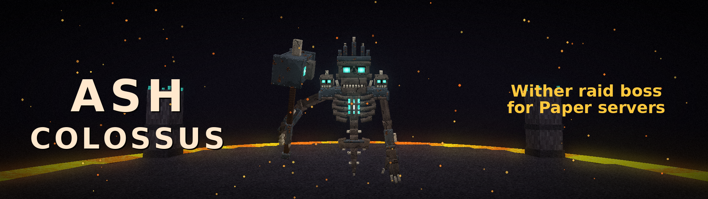

# Ash Colossus · Wither Boss



A three-phase Wither raid boss for **Paper 26.2** (Java 25). The Ash Colossus has its own arena world, its own custom model and animations, 21 telegraphed attacks, minions, music and a resource pack that ships inside the plugin jar. Nothing else to install.

**Made by NikeyV1 (Buffed SMP).** The boss was originally built for our own server. We publish it because we want other servers to get the chance to face this boss too. The resource pack is part of the release, free to use.

## Highlights

- Three phases (Embers, Consuming Hammer, Core Meltdown), 21 attacks, ash sentinels, beacons, shared revives
- **Custom loot you define in-game** (`/witherboss loot`), saved to `loot.yml`: any item with its enchantments and name, commands, XP, chance, amount, and who receives it
- **Difficulty presets** (EASY, NORMAL, HARD, NIGHTMARE) and a full `config.yml`: boss HP, damage per attack and phase, enrage, minions, revives, time limit, disabled attacks
- Defaults tuned so the second half of the fight stays fair without special potions
- Trigger modes: Colossus Sigil (default), classic Wither build, or command only
- Cooldown, time window, world restrictions, one-time event mode, refunds for failed starts
- Discord webhook announcements, English only, no other dependencies

## Install

1. Use Paper 26.2 with Java 25.
2. Put `WitherBoss-1.0.0.jar` into `plugins/` and start the server.
3. Done. The arena world `wither_boss_forge` is built on first start, the resource pack is offered to players when they enter the arena.

### Awakening the boss

| `event.trigger` | How |
| --- | --- |
| `SIGIL` (default) | Build a Wither (T of soul sand plus three skulls) while holding a **Colossus Sigil** in your other hand. Normal Withers stay vanilla, so beacons keep working. Craft the sigil (4 Wither skulls, 4 soul sand, 1 nether star, editable in `config.yml`) or hand it out with `/witherboss give sigil`. |
| `WITHER_BUILD` | Every Wither build awakens the Colossus. This is how it ran on Buffed SMP. |
| `COMMAND` | Only `/witherboss summon`. |

After the summoning, everyone within 50 blocks is pulled into the arena, everyone else gets a clickable **[Join]**. Fighters agree within the preparation time (45 s), the fight starts with at least `event.min-participants` confirmed fighters.

## Commands

| Command | Who | What |
| --- | --- | --- |
| `/witherboss info` | everyone | State of the boss and how to summon it |
| `/witherboss join`, `accept`, `leave` | everyone | Take part in a fight or preparation |
| `/witherboss claim` | everyone | Collect rewards that did not fit the inventory |
| `/witherboss pack` | everyone | Load the boss resource pack |
| `/witherboss about` | everyone | Credits |
| `/witherboss summon` | `witherboss.admin` | Start the real event, ignores the conditions |
| `/witherboss rehearse [seconds]` | `witherboss.admin` | Private full run without rewards |
| `/witherboss test [arena] [attack]` | `witherboss.admin` | Test fight or one single attack |
| `/witherboss stop` | `witherboss.admin` | End the preparation or fight |
| `/witherboss loot ...` | `witherboss.admin` | Loot editor (see below) |
| `/witherboss give sigil [player] [amount]` | `witherboss.admin` | Hand out sigils |
| `/witherboss difficulty [preset]` | `witherboss.admin` | Show or set the preset |
| `/witherboss config get/set <path> [value]` | `witherboss.admin` | Edit `config.yml` in-game |
| `/witherboss cooldown reset` | `witherboss.admin` | Allow the next summoning immediately |
| `/witherboss reload` | `witherboss.admin` | Reload `config.yml` and `loot.yml` |
| `/witherboss arena <set|build|rebuild|list|remove> [name]` | `witherboss.admin` | Arena management |

Aliases: `/wboss`, `/colossus`. Permissions: `witherboss.admin` (op), `witherboss.summon` (op, only for trigger `COMMAND`).

## Loot

`/witherboss loot` opens the editor. Put an item on an empty slot (or shift-click it in your inventory) to add it. The item is **copied**, with enchantments, name, lore and custom data. Click an entry to change:

- **chance** (0 to 100 %)
- **amount** (min and max)
- **who gets it**: `EACH_PLAYER` (everyone rolls separately), `RANDOM_PLAYER` (one lucky fighter) or `TOP_DAMAGE`
- enabled or disabled, or delete it

Command line versions: `loot list`, `loot add [chance] [min] [max]` (item in hand), `loot addcommand <chance> <command>` (console command, `%player%` is the winner), `loot addxp <chance> <min> [max]`, `loot set <id> <chance|min|max|scope|enabled> <value>`, `loot remove <id>`, `loot preview [rolls]`, `loot reset confirm`.

Rewards are stored as claims before anything is handed out. A full inventory, a crash or an offline winner never loses loot: it waits for `/witherboss claim` and is delivered on the next join. Fighters share in the loot with at least `loot.min-damage` damage dealt, or any revive or minion kill.

Default table: nether star, netherite scrap, diamonds, enchanted golden apple, totem, beacon (one random fighter), XP and the Ash Colossus Trophy (a bound cosmetic with a particle effect).

## Difficulty

The Buffed SMP version of this boss was easy until about half of its health and almost impossible afterwards. Our group needed Turtle Master potions to finish it. This release fixes that:

| | Original | `NORMAL` default |
| --- | --- | --- |
| Damage, phase I | x1.00 | x0.90 |
| Damage, phase II | x1.08 | x0.70 |
| Damage, phase III | x1.15 | x0.60 |
| Enrage | +3 % per minute, 8 stages | +2 % per 75 s, 5 stages |
| Pause between attacks | 1.0 | 1.1 |
| Revives | 3 | 5 |
| Phase III meltdown timer | 5:00 | 7:00 |
| Time limit | 20 min | 25 min |
| Sentinels | 100 % | 90 % HP, 80 % damage, 85 % count |
| Items on defeat or logout | lost | kept (switchable) |

In numbers: a late-fight attack now deals roughly half of what it did before. Presets scale on top of that: `EASY` (-20 % HP, -30 % damage, +2 revives), `HARD` (+25 % HP, +30 % damage, -1 revive), `NIGHTMARE` (+50 % HP, +75 % damage, -2 revives, fast enrage). Everything else is in `config.yml` with comments. `/witherboss difficulty` and `/witherboss config` change it live.

More on the fight itself: [docs/FIGHT-GUIDE.md](docs/FIGHT-GUIDE.md).

## Resource pack

The pack (`WitherBoss-Pack-1.0.0.zip`, CC0) is inside the jar. By default it is downloaded from this repository, which works without any setup. Options in `resource-pack`:

- `url: default` uses the repository copy, or put your own HTTPS link to the zip
- `self-host.enabled: true` lets the plugin serve the pack itself (open the TCP port, set `public-address`)
- `enabled: false` if you ship the pack yourself, merge it into your own server pack

The pack is only offered when a player enters the arena. Fighters must have it loaded, otherwise the boss would be invisible.

## Building

```bash
mvn -B verify
```

The jar is `target/WitherBoss-1.0.0.jar`. Needs JDK 25. A Paper runtime check plugin lives in `src/test/paper/`, see its README.

## Credits and license

Ash Colossus by **NikeyV1** for **Buffed SMP**. Code under GPL-3.0, see [LICENSE](LICENSE). Models, textures, animations, sounds and music of the resource pack are original work released as CC0. Minecraft is a trademark of Mojang Studios, this project is not affiliated with Mojang or Microsoft.
